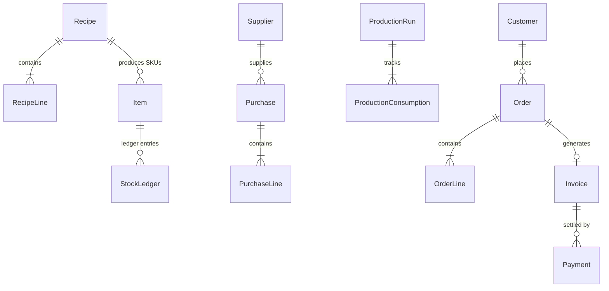

# SnackFlow ERP — Architecture & Design Note

## 1. Data Model & ER Diagram

All operational modules converge on the immutable `StockLedger` and `AuditLog`. No table stores a mutable `current_stock` column.

---

## 2. Two-Tier BOM & Live Extensibility

Food manufacturers produce a single bulk dough/mix in large batches and pack it into multiple retail SKU weights. SnackFlow ERP separates manufacturing into two tiers:

- **Tier 1 — Base Recipe (`Recipe` + `RecipeLine`):** Defines the bulk mix (`Murukku Bulk Mix`, `batchYieldG = 40000g`) in terms of raw materials (`40 kg Flour`, `10 L Oil`, `1.2 kg Spice Mix`).
- **Tier 2 — Finished SKU (`Item`):** Links `recipeId` to a specific pack weight (`packWeightG = 200`), pouch (`pouchItemId`), and carton (`cartonItemId`, `packetsPerCarton = 20`).

Expected batch output is derived dynamically as `(batches * recipe.batchYieldG) / item.packWeightG` (`40,000 / 200 = 200 packets/batch`). Adding a **500g Murukku** SKU requires only inserting one `Item` row with `packWeightG = 500` and `recipeId = "recipe-murukku-bulk-mix"` (`40,000 / 500 = 80 packets/batch`)—zero recipe duplication.

---

## 3. Ledger-Based Inventory & Zero-Drift Math

- **Single Source of Truth:** Every stock movement (`OPENING`, `PURCHASE`, `PRODUCTION_ISSUE`, `PRODUCTION_OUTPUT`, `DISPATCH`, `ADJUSTMENT`) appends an immutable row to `StockLedger`. On-hand stock is always computed inside PostgreSQL transactions via `SUM(StockLedger.qtyDelta)`.
- **Zero-Drift Arithmetic:**
  - All monetary values (rates, taxable totals, CGST/SGST/IGST, payments) are stored and computed strictly as **integer paisa** (`₹50.00 = 5000`), eliminating IEEE-754 floating-point rounding errors.
  - All physical quantities and unit costs use Prisma `Decimal` (`DECIMAL(14, 4)`) backed by `Decimal.js`.
- **1-Click Integrity Verification:** `GET /api/reports/integrity-check` reconciles `Opening + Receipts - Issues === Closing` for every item and `Total Invoiced - Payments - Credit Notes === Outstanding` across all accounts receivable.

---

## 4. Costing & Valuation Method

SnackFlow ERP uses **Moving Weighted Average Cost (WAC)** for raw materials and packaging, combined with **Direct Run Overhead Allocation** for finished goods:

1. **Moving WAC (`getCurrentWAC`):** Replays `StockLedger` chronologically. On each receipt (`qtyDelta > 0`), `newWAC = (prevQty * prevWAC + qtyDelta * unitCostPaisa) / (prevQty + qtyDelta)` rounded to 4 decimal places.
   - *Benchmark Flour Example:* Opening `100 kg @ 4200 paisa` (`420,000`) + Purchase `60 kg @ 4500 paisa` (`270,000`) = `690,000 / 160 kg = 4312.5000 paisa/kg` (`₹43.125/kg`).
2. **Production Run Costing (`costPerPacketPaisa`):** Before deducting stock, the run snapshots each ingredient's and packaging item's current WAC:
   - Materials: `40 * 4312.5` (Flour) `+ 10.5 * 14000` (Oil) `+ 1.2 * 20000` (Spice) = `343,500 paisa`
   - Packaging: `194 * 250` (188 good + 6 damaged pouches) `+ 9 * 1500` (cartons) = `62,000 paisa`
   - Direct Labour & Overhead: `120,000 + 60,000 = 180,000 paisa`
   - Total Run Cost = `585,500 paisa` across `188` good packets -> `Math.round(585500 / 188) = 3114 paisa/packet` (**₹31.14/packet**).
   - Against the `₹50.00` (`5000 paisa`) selling price, this yields a **₹18.86/packet (37.7% gross margin)** and is written back to `StockLedger` as the `PRODUCTION_OUTPUT` unit cost.
